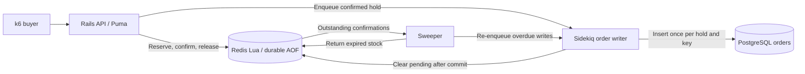

# Flashpoint

[](https://github.com/CharlieNotChilly/Flash-Point/actions/workflows/ci.yml)

Flashpoint is a flash-sale checkout engine built with Ruby on Rails, Redis Lua, Sidekiq, PostgreSQL, and k6. Redis reserves stock for a limited time. When a buyer confirms, Sidekiq writes the order to PostgreSQL. A reconciler recovers confirmations whose jobs were interrupted.

[Watch the 60-second demo](docs/flashpoint-demo.mp4) for excerpts from the recorded load test and chaos pilot.

## Load test

On one Apple M5 Pro with 24 GiB RAM running macOS 26.5.2, k6 started 5,000 virtual buyers together against 1,000 units. Each buyer attempted checkout once. Both measured designs committed 1,000 orders and returned 4,000 sold-out responses. [Machine and Docker configuration](results/environment.md) · [Load summaries and raw evidence](results/load/summary.md)

| Design | Oversold units | Attempts/s | Full-checkout p99 (ms) |
|---|---:|---:|---:|
| A. Naive read-check-write | Unmeasured | — | — |
| B. PostgreSQL row lock | 0 | 1,059.99 | 4,588 |
| C. Flashpoint | 0 | 1,034.98 | 4,696 |

Flashpoint had slightly lower throughput on this machine. Its throughput divided by the row-lock baseline was **0.9×** under the spec’s round-down rule. For a successful Flashpoint buyer, the latency measurement includes both reserve and confirm through the HTTP acknowledgement. The invariant check waits for order persistence. [Measurement definitions](docs/SPEC.md)

## Chaos pilot

Each run killed one service mid-sale, restarted it, and compared acknowledged buyer keys with committed orders.

| Service killed | Run result | Stock invariant | Lost orders | Duplicate orders |
|---|---|---|---:|---:|
| Redis | Passed | Passed | 0 | 0 |
| Sidekiq | Failed | Passed | 0 | 0 |

The Sidekiq run recorded **167 unexpected checkout outcomes**, which failed the k6 threshold. Both order audits balanced. The required 50-run campaign is outstanding. [Pilot report](results/chaos/20261124T053733603868Z/summary.json) · [Failed k6 run](results/chaos/20261124T053733603868Z/02-k6.json)

## How it works



Redis checks stock, deducts the quantity, and creates the hold in one Lua call. Confirm adds the hold to the pending set before Rails enqueues the job. If the worker stops between the PostgreSQL commit and Redis acknowledgement, the retried job finds the existing order and clears the pending entry. [Architecture and data model](docs/DESIGN.md)

## Running it

From the repository root, start Docker Desktop or Docker Engine and run:

```sh
docker compose up --build -d --wait
curl -fsS http://localhost:3000/up
docker compose exec web bin/rails runner 'p Product.pluck(:sku, :initial_stock, :stock)'
docker compose logs --tail=5 sweeper
```

On first boot, Rails prepares PostgreSQL and seeds `FLASH-1`. Subsequent boots preserve stock and orders. Sidekiq connects to Redis and the sweeper logs a heartbeat every second. To change Puma concurrency, set `WEB_CONCURRENCY` and `RAILS_MAX_THREADS` when starting Compose.

On a freshly seeded stack, run `test/phase_one_smoke.sh` to check Rails, the seed, Redis durability, Sidekiq registration, and sweeper activity.

Run `docker compose down` to stop the stack. PostgreSQL and Redis store their data in named volumes.

## PostgreSQL checkout baselines

Both endpoints accept a JSON body such as `{"sku":"FLASH-1","qty":1}`. A purchase returns `201` with an `order_id`. Insufficient stock returns `409` with `{"error":"SOLD_OUT"}`.

- **Design A** (`POST /naive/checkout`) reads stock without locking the row and writes the balance calculated in Ruby. Concurrent buyers can both read the same balance.
- **Design B** (`POST /locked/checkout`) reads the product with `SELECT ... FOR UPDATE`. PostgreSQL holds the row lock until the stock update and order insert commit together.

Run the request specs against the test database:

```sh
docker compose exec -e RAILS_ENV=test web bin/rails db:prepare
docker compose exec -e RAILS_ENV=test web bundle exec rspec
```

Between runs, `docker compose exec web bin/rails checkout:reset` deletes development orders for designs A and B and restores each product’s stock to its initial value.

Run `bin/load_test locked` and `bin/load_test flashpoint` sequentially from the host. Each command starts a fresh local Compose project, runs k6, checks persisted orders against successful HTTP checkouts, and removes its temporary containers and volumes. The Flashpoint invariant waits for confirmed orders to drain. Raw k6 summaries and inventory checks share a timestamp in `results/load/`. Run `bin/summarize_load` to regenerate `results/load/summary.md` from the most recent saved evidence for each design.

## Redis reservations

After rebuilding Compose, run `docker compose exec web bin/rails db:seed` once for an existing installation. The seed initializes the Redis allocation for `FLASH-1` and preserves an existing balance. The PostgreSQL and Redis allocations belong to separate benchmark designs.

`POST /reserve` accepts `sku` and a positive integer `qty` and returns a hold ID and an expiry in Unix epoch milliseconds. `HOLD_TTL_SECONDS` controls the reservation lifetime (default 60 seconds). Send the hold ID as `hold_id` to `POST /confirm` or `POST /release`. Confirmation at or after the deadline returns `410 HOLD_EXPIRED`. A successful confirmation adds the hold to `confirmed:pending`. Release restores stock for a held reservation exactly once. The sweeper returns expired stock every second. Sidekiq writes confirmed orders to PostgreSQL and removes their pending entries after commit. The sweeper re-enqueues confirmations that have been pending for more than five seconds. On startup, the web service rebuilds a missing Redis stock balance before Puma accepts requests.

After traffic stops, run `docker compose exec web bin/check_invariant flashpoint` to wait for pending writes and check Redis stock, active holds, and committed Flashpoint orders. The default invocation still checks the PostgreSQL checkout baselines.

Use one `Idempotency-Key` header value per checkout attempt. Send the same key on reserve, confirm, and retries of either request. Repeated reserves return the original hold ID and deadline (or the original sold-out response). Repeated confirmations return the same pending response. Replaying a released reservation returns its original receipt and leaves the stock available.

## Project docs

- [docs/SPEC.md](docs/SPEC.md): acceptance criteria
- [docs/DESIGN.md](docs/DESIGN.md): architecture and decisions
- [docs/PLAN.md](docs/PLAN.md): build phases
